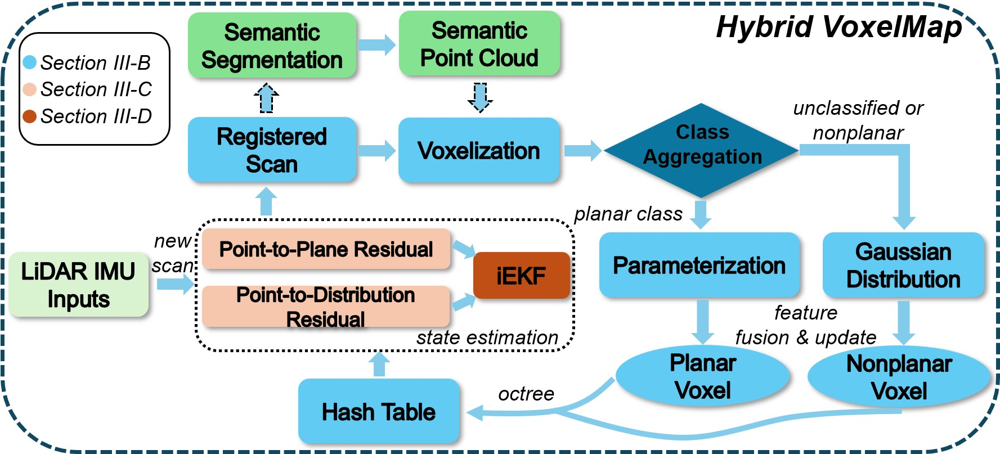
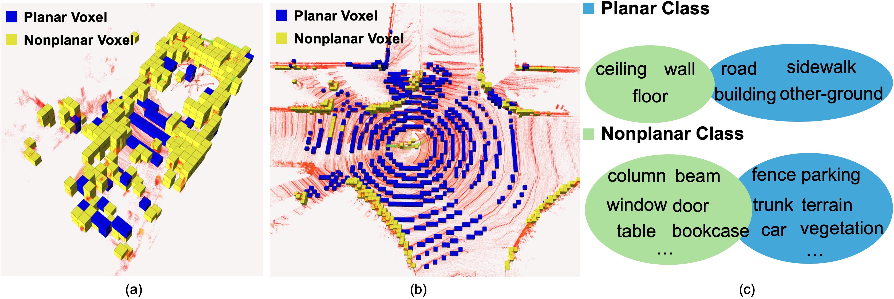

# Hybrid-VoxelMap ROS 2

<div align="center">
  <a href="https://youtu.be/9RCtITLkl84">
    
  </a>
  <br>
  <b>Click the image to watch the demo video</b>
</div>

**Hybrid-VoxelMap** is a semantic-driven LiDAR-inertial odometry system that extends VoxelMap / VoxelMap++ by selecting a local map representation according to semantic cues:

1. Each voxel can be represented as either a plane or a Gaussian distribution.
2. A unified scan-matching model combines point-to-plane and probabilistic constraints.
3. The ROS 2 version supports KITTI / SemanticKITTI-style Velodyne data and Livox Mid-70 + IMU data.

This ROS 2 port has been adapted and build-verified with ROS 2 Jazzy on Ubuntu 24.04.

<div align="center">
    
</div>
<div align="center">
    
</div>

## Related Paper

[Gaussian or Plane? Both: Semantic-Driven Voxel Representation for LiDAR-Inertial Odometry](https://ieeexplore.ieee.org/document/11247866)

## Updates

- **2026-10-03**: Updated to Ubuntu 24.04 / ROS 2 Jazzy (`ros2-jazzy`). Fixed IMU propagation, covariance frames and voxel neighbor selection, and improved ROS 2 shutdown. Added Hilti-Oxford 2022 support and configurable 26-neighbor Gaussian search and calibrated IMU noise, both enabled by default.
- **2026-05-24**: Released the ROS 2 Humble version.
- **2025-11-18**: Released the ROS 1 Noetic code.

## 1. Prerequisites

### 1.1 ROS 2

The Jazzy port was build-verified with:

```text
Ubuntu 24.04
ROS 2 Jazzy
PCL >= 1.12
Eigen >= 3.3
```

Install common dependencies:

```bash
sudo apt update
sudo apt install -y \
  ros-jazzy-desktop \
  ros-jazzy-pcl-conversions \
  ros-jazzy-tf2 \
  ros-jazzy-tf2-geometry-msgs \
  ros-jazzy-tf2-ros \
  ros-jazzy-rosbag2 \
  ros-jazzy-rviz2 \
  python3-colcon-common-extensions \
  libpcl-dev \
  libeigen3-dev
```

### 1.2 Livox Support

Livox datasets such as MCD Mid-70 require Livox-SDK2 and `livox_ros_driver2` because the LiDAR input uses `livox_ros_driver2/msg/CustomMsg`. These steps install the SDK into the user's home directory, so they do not need system-wide write access.

```bash
git clone https://github.com/Livox-SDK/Livox-SDK2.git ~/Livox-SDK2
cmake -S ~/Livox-SDK2 -B ~/Livox-SDK2/build \
  -DCMAKE_BUILD_TYPE=Release -DCMAKE_INSTALL_PREFIX=$HOME/.local
cmake --build ~/Livox-SDK2/build --parallel 8
cmake --install ~/Livox-SDK2/build

mkdir -p ~/ros2_ws/src
cd ~/ros2_ws/src
git clone https://github.com/Livox-SDK/livox_ros_driver2.git
cd livox_ros_driver2
source /opt/ros/jazzy/setup.bash
export CMAKE_PREFIX_PATH="$HOME/.local${CMAKE_PREFIX_PATH:+:$CMAKE_PREFIX_PATH}"
./build.sh jazzy
source ~/ros2_ws/install/setup.bash
export LD_LIBRARY_PATH="$HOME/.local/lib${LD_LIBRARY_PATH:+:$LD_LIBRARY_PATH}"
```

If `livox_ros_driver2` is not found when building Hybrid-VoxelMap, the package can still build, but Livox `CustomMsg` input and its related bridge executables will be disabled.

## 2. Build

Create a ROS 2 workspace and build with `colcon`:

```bash
mkdir -p ~/slam_ws/src
cd ~/slam_ws/src
git clone -b ros2-jazzy https://github.com/haiyang2022/Hybrid-VoxelMap.git

cd ~/slam_ws
source /opt/ros/jazzy/setup.bash
[ -f ~/ros2_ws/install/setup.bash ] && source ~/ros2_ws/install/setup.bash
colcon build --symlink-install --cmake-args -DCMAKE_BUILD_TYPE=Release
source install/setup.bash
```

The build enables OpenMP residual matching automatically. On high-core CPUs, the default thread count is capped conservatively; it can be overridden with:

```bash
colcon build --symlink-install --cmake-args -DCMAKE_BUILD_TYPE=Release -DHVM_OMP_NUM_THREADS=8
```

## 3. Input Format

The odometry node is:

```bash
ros2 run hybrid_voxel_map voxel_mapping_odom
```

It subscribes to:

- LiDAR topic configured by `common.lid_topic`
- IMU topic configured by `common.imu_topic` when `imu.imu_en=true`

For semantic mode, Hybrid-VoxelMap expects the LiDAR `PointCloud2` message to contain a `semantic` field:

```text
0: unknown / unused
1: planar semantic region
2: non-planar Gaussian semantic region
3: moving object / ignored object region
```

If no semantic field is present, the system falls back to Gaussian-only mapping.

Any semantic segmentation method can be connected as long as it provides one label for each input LiDAR point, in the same point order as the input cloud. There are two recommended integration paths:

1. Direct output: publish a `sensor_msgs/msg/PointCloud2` that preserves the original point fields and adds `semantic` as `UINT32`.
2. Adapter output: publish per-point labels on a separate topic, then use `generic_semantic_field_bridge.py` to add the Hybrid-VoxelMap `semantic` field.

The generic adapter supports:

- `sensor_msgs/msg/PointCloud2` label output with a configurable label field such as `label`, `pred`, or `semantic`.
- `std_msgs/msg/UInt32MultiArray` / `std_msgs/msg/Int32MultiArray` label output when labels are published in the same frame order as the raw clouds.
- Dataset label IDs mapped to Hybrid-VoxelMap categories through `--plane-labels`, `--object-labels`, and `--ignore-labels`.
- Already-remapped Hybrid-VoxelMap labels through `--input-label-space hybrid`.

## 4. Run with ROS 2 Bags

The examples below use converted ROS 2 bags. Replace `/path/to/...` with your bag path.

### 4.1 KITTI 08

Dataset bag:

```text
kitti08_raw_pointcloud2_ros2
topic: /velodyne_points_raw
type:  sensor_msgs/msg/PointCloud2
rate:  10 Hz
```

KITTI does not provide IMU in the odometry benchmark. In this ROS 2 version, `imu.imu_en=false` is used and the front end falls back to a LiDAR constant-velocity prediction and deskew model. The converted bag contains a per-point `time` field so the fallback deskew can be used consistently.

Terminal 1, start Hybrid-VoxelMap:

```bash
source /opt/ros/jazzy/setup.bash
[ -f ~/ros2_ws/install/setup.bash ] && source ~/ros2_ws/install/setup.bash
source ~/slam_ws/install/setup.bash

mkdir -p ~/hvm_results

ros2 run hybrid_voxel_map voxel_mapping_odom --ros-args \
  --params-file $(ros2 pkg prefix hybrid_voxel_map)/share/hybrid_voxel_map/config/kitti08.yaml \
  -p common.lid_topic:=/velodyne_points_raw \
  -p imu.imu_en:=false \
  -p imu.use_lidar_constant_velocity:=true \
  -p imu.use_lidar_constant_velocity_deskew:=true \
  -p Result.tum_result_path:=$HOME/hvm_results/kitti08_hybrid_voxel_map_tum.txt \
  -p Result.efficiency_path:=$HOME/hvm_results/kitti08_hybrid_voxel_map_efficiency.txt
```

Terminal 2, play the bag:

```bash
source /opt/ros/jazzy/setup.bash
ros2 bag play /path/to/kitti08_raw_pointcloud2_ros2 --read-ahead-queue-size 10000
```

### 4.2 MCD ntu_day_10, Livox Mid-70 + VN100 IMU

Dataset bag:

```text
ntu_day_10_mid70_vn100_body_ros2
topics:
  /livox/lidar  livox_ros_driver2/msg/CustomMsg
  /vn100/imu    sensor_msgs/msg/Imu
```

This bag contains the Livox Mid-70 scan transformed into the VN100 body frame. The per-point Livox `offset_time` is preserved, and the original VN100 IMU stream is kept in the same bag with the original timestamps. Because the LiDAR is already in the body frame, the MCD example configuration uses identity LiDAR-IMU extrinsics.

Terminal 1, start Hybrid-VoxelMap:

```bash
source /opt/ros/jazzy/setup.bash
[ -f ~/ros2_ws/install/setup.bash ] && source ~/ros2_ws/install/setup.bash
source ~/slam_ws/install/setup.bash

mkdir -p ~/hvm_results

ros2 run hybrid_voxel_map voxel_mapping_odom --ros-args \
  --params-file $(ros2 pkg prefix hybrid_voxel_map)/share/hybrid_voxel_map/config/MCD_mid70_body_pure_ndt_adapted.yaml \
  -p Result.tum_result_path:=$HOME/hvm_results/mcd_ntu_day_10_hybrid_voxel_map_tum.txt \
  -p Result.efficiency_path:=$HOME/hvm_results/mcd_ntu_day_10_hybrid_voxel_map_efficiency.txt
```

Terminal 2, play the bag:

```bash
source /opt/ros/jazzy/setup.bash
[ -f ~/ros2_ws/install/setup.bash ] && source ~/ros2_ws/install/setup.bash
ros2 bag play /path/to/ntu_day_10_mid70_vn100_body_ros2 --read-ahead-queue-size 10000
```

### 4.3 KITTI 08 with an External Semantic Front End

In this example, an external semantic segmentation node subscribes to `/velodyne_points_raw` and publishes per-point labels on `/semantic_labels`. The generic adapter converts those labels into the Hybrid-VoxelMap `semantic` field and republishes `/velodyne_points_semantic`.

Terminal 1, start Hybrid-VoxelMap:

```bash
source /opt/ros/jazzy/setup.bash
[ -f ~/ros2_ws/install/setup.bash ] && source ~/ros2_ws/install/setup.bash
source ~/slam_ws/install/setup.bash

mkdir -p ~/hvm_results

ros2 run hybrid_voxel_map voxel_mapping_odom --ros-args \
  --params-file $(ros2 pkg prefix hybrid_voxel_map)/share/hybrid_voxel_map/config/kitti08.yaml \
  -p common.lid_topic:=/velodyne_points_semantic \
  -p imu.imu_en:=false \
  -p imu.use_lidar_constant_velocity:=true \
  -p imu.use_lidar_constant_velocity_deskew:=true \
  -p Result.tum_result_path:=$HOME/hvm_results/kitti08_semantic_tum.txt \
  -p Result.efficiency_path:=$HOME/hvm_results/kitti08_semantic_efficiency.txt
```

Terminal 2, start your semantic segmentation method:

```bash
source /opt/ros/jazzy/setup.bash

# Replace this with your own segmentation command.
# Required behavior:
#   subscribe: /velodyne_points_raw
#   publish:   /semantic_labels
#   type:      sensor_msgs/msg/PointCloud2
#   field:     label, one label per input point, same point order
ros2 run your_semantic_package your_semantic_node --ros-args \
  -p input_topic:=/velodyne_points_raw \
  -p output_topic:=/semantic_labels
```

Terminal 3, start the generic semantic adapter:

```bash
source /opt/ros/jazzy/setup.bash
[ -f ~/ros2_ws/install/setup.bash ] && source ~/ros2_ws/install/setup.bash
source ~/slam_ws/install/setup.bash

ros2 run hybrid_voxel_map generic_semantic_field_bridge.py \
  --raw-topic /velodyne_points_raw \
  --label-topic /semantic_labels \
  --output-topic /velodyne_points_semantic \
  --label-message-type pointcloud2 \
  --label-field label \
  --input-label-space dataset \
  --plane-labels 8,9,10,11,12,13,16 \
  --object-labels 0,1,2,3,4,5,6,7 \
  --sync-policy timestamp \
  --max-stamp-diff 0.02
```

The `--plane-labels` and `--object-labels` above assume SemanticKITTI learning IDs. If your method publishes raw SemanticKITTI IDs or already-remapped Hybrid-VoxelMap labels, change these arguments accordingly.

Terminal 4, play the KITTI bag:

```bash
source /opt/ros/jazzy/setup.bash
ros2 bag play /path/to/kitti08_raw_pointcloud2_ros2 --read-ahead-queue-size 10000
```

### 4.4 MCD ntu_day_10 with an External Semantic Front End

For online semantic segmentation on MCD, use the PointCloud2 version of the converted bag:

```text
ntu_day_10_mid70_vn100_body_pointcloud2_ros2
topics:
  /livox/lidar_raw_body  sensor_msgs/msg/PointCloud2
  /vn100/imu             sensor_msgs/msg/Imu
```

This bag still contains only raw LiDAR and IMU data. Semantic labels are not stored in the bag; they are produced online by your semantic front end.

Terminal 1, start Hybrid-VoxelMap:

```bash
source /opt/ros/jazzy/setup.bash
[ -f ~/ros2_ws/install/setup.bash ] && source ~/ros2_ws/install/setup.bash
source ~/slam_ws/install/setup.bash

mkdir -p ~/hvm_results

ros2 run hybrid_voxel_map voxel_mapping_odom --ros-args \
  --params-file $(ros2 pkg prefix hybrid_voxel_map)/share/hybrid_voxel_map/config/MCD_mid70_body_semantic_adapted.yaml \
  -p common.lid_topic:=/livox/lidar_semantic \
  -p Result.tum_result_path:=$HOME/hvm_results/mcd_ntu_day_10_semantic_tum.txt \
  -p Result.efficiency_path:=$HOME/hvm_results/mcd_ntu_day_10_semantic_efficiency.txt
```

Terminal 2, start your semantic segmentation method:

```bash
source /opt/ros/jazzy/setup.bash

# Replace this with your own segmentation command.
# Required behavior:
#   subscribe: /livox/lidar_raw_body
#   publish:   /mcd_semantic_labels
#   type:      sensor_msgs/msg/PointCloud2
#   field:     label, one label per input point, same point order
ros2 run your_semantic_package your_semantic_node --ros-args \
  -p input_topic:=/livox/lidar_raw_body \
  -p output_topic:=/mcd_semantic_labels
```

Terminal 3, start the generic semantic adapter:

```bash
source /opt/ros/jazzy/setup.bash
[ -f ~/ros2_ws/install/setup.bash ] && source ~/ros2_ws/install/setup.bash
source ~/slam_ws/install/setup.bash

ros2 run hybrid_voxel_map generic_semantic_field_bridge.py \
  --raw-topic /livox/lidar_raw_body \
  --label-topic /mcd_semantic_labels \
  --output-topic /livox/lidar_semantic \
  --label-message-type pointcloud2 \
  --label-field label \
  --input-label-space dataset \
  --plane-labels 2,6,10,12,15,17 \
  --object-labels 1,13,23 \
  --sync-policy timestamp \
  --max-stamp-diff 0.02
```

The MCD label IDs above are the mapping used in our experiments. You may adjust the planar / object sets for another MCD-compatible semantic taxonomy.

Terminal 4, play the MCD PointCloud2 bag:

```bash
source /opt/ros/jazzy/setup.bash
[ -f ~/ros2_ws/install/setup.bash ] && source ~/ros2_ws/install/setup.bash
ros2 bag play /path/to/ntu_day_10_mid70_vn100_body_pointcloud2_ros2 --read-ahead-queue-size 10000
```

### 4.5 Hilti-Oxford 2022

Use an already converted ROS 2 bag containing `/hesai/pandar` and `/alphasense/imu`. The adapter preserves point timestamps and transforms the LiDAR points into the IMU frame. Playback runs at 1x.

```bash
ros2 run hybrid_voxel_map run_hilti2022.py /path/to/ros2_bag --output ~/hvm_results/hilti2022
```

Configure `mapping.gaussian_neighbor_search` and `noise_model.use_calibrated_imu_noise` in `config/hilti2022.yaml` (both default to `true`). Noise calibration uses the first two seconds of stationary IMU data; disable it to use the configured noise values instead.

## 5. How the Example Bags Were Converted

### KITTI 08

The KITTI bag was generated from:

```text
dataset/sequences/08/velodyne/*.bin
dataset/sequences/08/times.txt
```

Each `.bin` scan was packed into `sensor_msgs/msg/PointCloud2` on `/velodyne_points_raw` with fields:

```text
x, y, z, intensity, time, ring
```

KITTI has no IMU. The ROS 2 bag therefore contains only LiDAR frames. The odometry configuration uses the constant-velocity fallback instead of IMU propagation.

### MCD ntu_day_10

The MCD bag was generated from the original Mid-70 LiDAR and VN100 IMU data. The conversion:

1. Rewrites Livox messages as `livox_ros_driver2/msg/CustomMsg`.
2. Transforms each Mid-70 point into the VN100 body frame using the dataset calibration.
3. Preserves each point's Livox `offset_time` for motion compensation.
4. Keeps `/vn100/imu` in the same bag with the original timestamps.

## 6. Notes on the ROS 2 Version

Compared with the original ROS 1 implementation, this ROS 2 version includes several practical updates:

- ROS 2 Jazzy / ament build support.
- `livox_ros_driver2` support for Livox `CustomMsg`.
- KITTI / SemanticKITTI sequence support through `PointCloud2`.
- A constant-velocity fallback path for datasets without IMU, such as KITTI odometry.
- TUM trajectory output and per-run efficiency logging.
- RViz2 configuration update for ROS 2 plugin names.
- OpenMP parallelization for scan-matching residual search on AGX Orin and desktop CPUs.
- Optional ROS 2 semantic front-end bridges for online semantic segmentation pipelines.
- Safer convergence / iteration handling.

The algorithmic interface remains the same: semantic information only changes the local map representation choice, while Gaussian-only mode is still available when no semantic field is provided.

## 7. Acknowledgments

This implementation is built upon [VoxelMap++](https://github.com/uestc-icsp/VoxelMapPlus_Public) and [VoxelMap](https://github.com/hku-mars/VoxelMap/tree/master). We thank the authors for their contributions.

## Citation

If you find this work useful in your research, please cite:

```bibtex
@article{HybridVoxelMap2026,
  author={Wu, Haiyang and Vosselman, George and Lehtola, Ville},
  title={Gaussian or Plane? Both: Semantic-Driven Voxel Representation for LiDAR-Inertial Odometry},
  journal={IEEE Robotics and Automation Letters},
  year={2026},
  volume={11},
  number={1},
  pages={161-168},
  doi={10.1109/LRA.2025.3632730},
}
```
